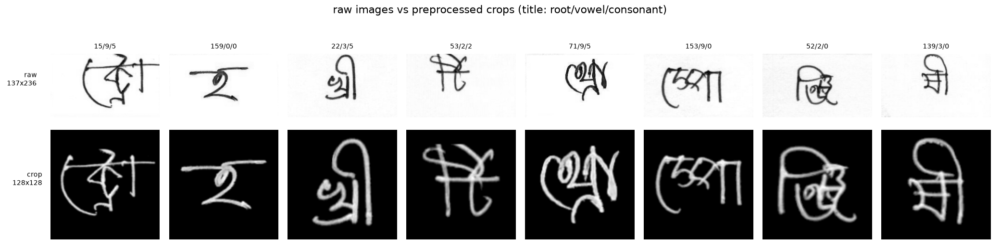
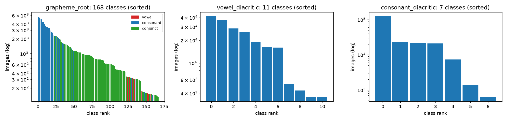
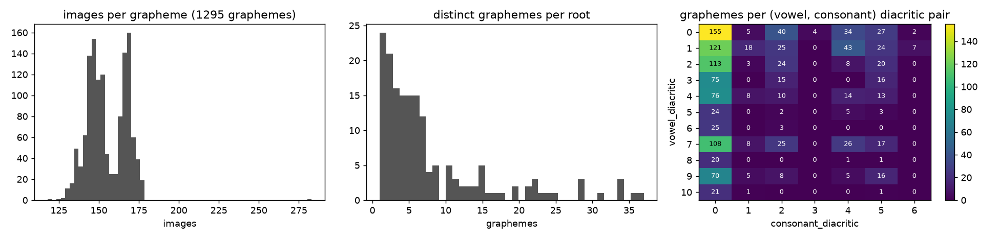
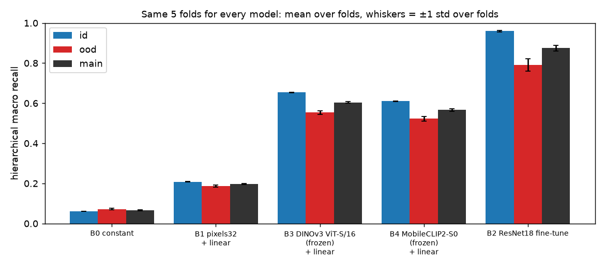
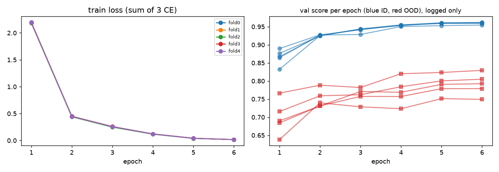
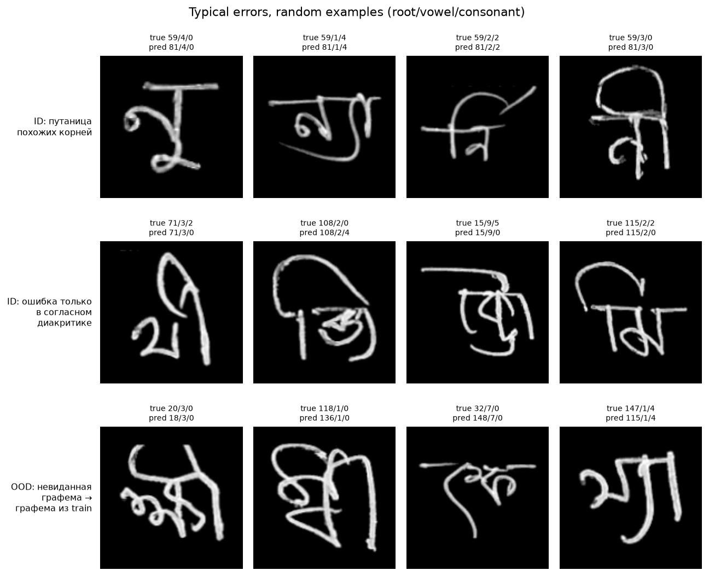
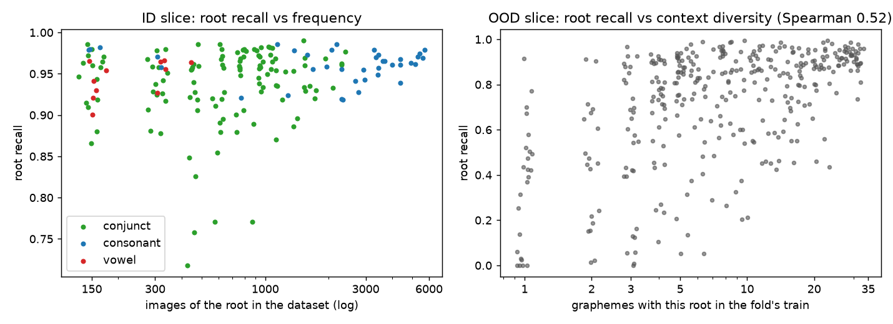
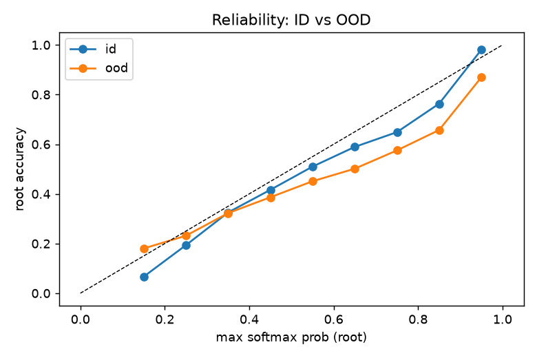

# Bengali.AI Handwritten Grapheme Classification — ДЗ1 (ML R&D)

Постановка задачи, честный baseline, протокол оценки без утечек и воспроизводимый пайплайн для соревнования
[Bengali.AI Handwritten Grapheme Classification](https://www.kaggle.com/competitions/bengaliai-cv19) (Kaggle, 2019–2020).

**TL;DR.** Нужно по изображению рукописной бенгальской графемы предсказать три компоненты: корень (168 классов), гласный (11) и согласный диакритик (7). Метрика — иерархический macro-recall.

Протокол: 5 фолдов, в каждом два среза. ID — знакомые графемы. OOD — 130 графем, целиком убранных из train; это прокси невиданных графем private-теста. Основная метрика `main = (R_ID + R_OOD)/2`.

Основной бейзлайн — ImageNet-ResNet18 с тремя линейными головами, 6 эпох без аугментаций:
- **main = 0.875 ± 0.015** (среднее ± std по фолдам; ID 0.959, OOD 0.791);
- это в 13 раз выше константы (0.066) и в 4.4 раза выше линейной модели на пикселях (0.198);
- замороженные DINOv3 и MobileCLIP2 с линейными головами дают лишь 0.604 и 0.566.

Гипотеза «main > 0.9» **не подтвердилась**. Узкое место — невиданные графемы: на OOD корень ошибочен в 25% случаев против 5% на ID. В 88% OOD-ошибок модель выдаёт знакомую по train графему, при уровне случайности 71%. Recall корня на OOD сильно зависит от того, в скольких разных графемах корень встречался в train.

Следующая гипотеза (ДЗ2): аугментации и регуляризация, ломающие «запоминание графемы целиком», поднимут OOD сильнее, чем ID.

---

## 0. Как запустить

Требования: Python 3.11–3.12, [uv](https://docs.astral.sh/uv/), ~12 ГБ на диске. Код выбирает устройство сам (CUDA → Apple MPS → CPU); все числа ниже получены на Apple M4 Pro (MPS, 48 ГБ RAM).

```bash
uv sync                          # окружение по uv.lock; без uv: pip install -r requirements.txt && pip install -e .
                                 # (скрипты в scripts/ вызывают `uv run`; без uv запускайте те же команды как `python -m ...`)
bash scripts/download_data.sh    # 5.18 ГБ; нужно принять правила соревнования и положить API-токен в ~/.kaggle/kaggle.json
                                 # (или скачать архив вручную со страницы Data и распаковать в data/raw/)
bash scripts/prepare.sh          # предобработка 128x128 (~3 мин), фолды, EDA
bash scripts/run_smoke.sh        # тесты + обучение на подвыборке за ~2 мин — проверка, что всё работает
bash scripts/run_baseline.sh     # все бейзлайны на 5 фолдах + seed-исследование + оценка (~2.5 ч на M4 Pro)
```

Отдельные шаги:

```bash
uv run python -m bengali.train --config configs/baseline.yaml --fold 0 --seed 42     # один фолд B2
uv run python -m bengali.train --config configs/baseline.yaml --fold 0 \
    --set train.epochs=1 experiment=b2_debug output_dir=results/_debug save_checkpoint=false   # переопределение параметров (неизвестный ключ — ошибка)
uv run python -m bengali.probe --config configs/probe_dinov3.yaml                    # linear probe на DINOv3
uv run python -m bengali.evaluate                                                    # таблицы, CI, анализ ошибок, графики
```

Структура репозитория:

```text
├── configs/          # YAML-конфиги экспериментов (common.yaml наследуется остальными)
├── scripts/          # download_data.sh, prepare.sh, run_smoke.sh, run_baseline.sh
├── src/bengali/
│   ├── data.py       # parquet -> предобработанные массивы (crop + resize)
│   ├── splits.py     # протокол валидации: 5 фолдов со срезами ID и OOD
│   ├── metric.py     # метрика соревнования, срезы, бутстрап-CI
│   ├── models.py     # ResNet18 с 3 головами; замороженные энкодеры (pixels / DINOv3 / MobileCLIP2)
│   ├── train.py      # fine-tune (B2)
│   ├── probe.py      # linear probe на замороженных признаках (B1, B3, B4)
│   ├── baselines.py  # константа (B0)
│   ├── runs.py       # загрузка фолда, сохранение предсказаний и метрик
│   ├── utils.py      # конфиги (base-наследование, --set), seed, выбор устройства
│   ├── eda.py        # EDA -> reports/
│   └── evaluate.py   # агрегация запусков, парные сравнения, анализ ошибок -> results/, reports/figures/
├── splits/folds.csv  # зафиксированное разбиение: только image_id, id_fold, ood_group (детерминировано, seed=42)
├── results/          # метрики и OOF-предсказания (без меток) каждого запуска, summary.md/json
├── reports/          # EDA, список почти точных копий, графики
├── logs/             # логи всех прогонов
├── pyproject.toml, uv.lock, requirements.txt
└── tests/            # метрика vs эталон Kaggle/sklearn, отсутствие утечек в сплитах, предобработка
```

---

## 1. Постановка задачи

**Что предсказываем.** По изображению одной рукописной бенгальской графемы нужно определить три её составляющие:
корень графемы (`grapheme_root`, 168 классов), гласный диакритик (`vowel_diacritic`, 11 классов, включая «нет диакритика»)
и согласный диакритик (`consonant_diacritic`, 7 классов, включая «нет»).

**Объект предсказания** — одно изображение 137×236 (grayscale) с одной графемой, вырезанное из отсканированного бланка, который заполнил доброволец.

**Что доступно на момент предсказания** — только пиксели изображения. Автор, бланк, строка `grapheme` и прочие метаданные на inference недоступны.

**Почему это имеет практический смысл.** По данным страницы соревнования, бенгальский — 5-й язык мира по числу носителей. В бенгальской письменности графема (минимальная единица письма) состоит из корня и диакритиков, возможных графем ~13 000 (там же), а в обучающей выборке их только 1 295. Распознавание графемы *по компонентам*, а не как одного класса из 13 000, позволяет собрать OCR, который узнаёт графемы, ни разу не встречавшиеся в обучающих данных. Это и есть главная идея постановки: на Kaggle скрытый тест содержит около 900 графем, которых нет в train («the test set includes some graphemes that do not exist in train but has no new grapheme components»).

**Ограничения задачи:**
- в тесте **другие авторы** (нет пересечения авторов с train) и **невиданные графемы** (88% из них — в private-части), поэтому public LB был оптимистичен (у победителя 0.995 public против 0.976 private);
- нет идентификатора автора в train → нельзя сделать group-split по авторам;
- сильный дисбаланс корней и шум в разметке (ошибки OCR при извлечении из бланков, ≈450 строк с двумя согласными диакритиками размечены одним классом);
- это code competition: инференс в ноутбуке без интернета, ≤2 ч на GPU. Для ДЗ1 это не критично, но ограничивает размер будущих моделей;
- вычислительный бюджет этой работы — один ноутбук (Apple M4 Pro), ≈2.5 ч на все бейзлайны.

**Основная гипотеза.**
> Если вместо константы (B0) и линейной модели на пикселях (B1) взять предобученную на ImageNet CNN (ResNet18) с тремя независимыми линейными головами и дообучить её end-to-end (B2), то основная метрика `main` (см. §5) вырастет кратно и превысит 0.9, потому что распознавание компонент требует инвариантных к почерку признаков формы штрихов, которых линейная модель на пикселях не выделяет. На невиданных графемах (OOD-срез) качество будет ниже, чем на знакомых (ID), но останется высоким: головы предсказывают компоненты независимо, а не графему целиком.

Проверка. Гипотеза состоит из трёх утверждений, каждое проверяется отдельно на одних и тех же 5 фолдах:
1. **Рост кратный:** `main(B2)` выше `main(B0)` и `main(B1)` на всех 5 фолдах, парный 95% бутстрап-CI разности целиком выше нуля, `main(B2) / main(B1) ≥ 2`.
2. **Порог:** среднее `main(B2)` по фолдам > 0.9.
3. **OOD ниже ID, но высокий:** `R_OOD < R_ID` на всех фолдах. Числовой порог для «высокого» в исходной формулировке не был зафиксирован; это недостаток гипотезы, и задним числом я его не ввожу. В §6 этот пункт оценивается по факту.

Результат — в §6–7.

---

## 2. Формализация задачи

| | |
|---|---|
| `X` | изображение `x ∈ {0..255}^{137×236}` (на вход моделям — центрированный crop 128×128, см. §4) |
| `y` | тройка `(y_root ∈ {0..167}, y_vowel ∈ {0..10}, y_cons ∈ {0..6})` |
| тип задачи | **multi-target multiclass**: три многоклассовые задачи с общим входом (не multilabel: в каждой голове ровно один класс) |
| единица наблюдения | изображение (один рукописный экземпляр графемы) |
| одно предсказание | тройка классов для одного изображения (в сабмите Kaggle — 3 строки `Test_i_<component>`) |
| признаки на inference | только пиксели. Колонка `grapheme` используется **только** для построения сплитов и анализа, не как признак |

---

## 3. Данные (EDA)

Код: `src/bengali/eda.py` → `reports/eda_summary.json`, `reports/figures/eda_*.png`.

**Размер и качество.**

| | |
|---|---|
| train | 200 840 изображений 137×236 uint8 (4 parquet по ~50k строк), `train.csv`: `image_id`, 3 метки, строка `grapheme` |
| test в архиве | 12 изображений (36 строк сабмита) — заглушка. Настоящий тест (~211k) виден только ноутбуку при сабмите |
| пропуски / дубликаты | 0 пропусков, 0 точных дубликатов изображений (md5), 0 почти пустых изображений, но **4 141 пара почти точных копий** (8 282 изображения, 4.1%; п. 6 ниже) |
| согласованность меток | у каждой из 1 295 графем ровно одна тройка `(root, vowel, cons)` |
| классы | все 168 / 11 / 7 классов присутствуют в train |
| комбинации | в train 1 295 графем (строк `grapheme`), им соответствуют 1 292 разные тройки меток из 168·11·7 = 12 936 возможных (10%). Три пары графем делят одну тройку (п. 4) |



*Сверху — сырые изображения, снизу — после crop + resize до 128×128 (подпись: root/vowel/consonant).* Графема занимает разную часть кадра (медиана bbox вместе с отступами crop — 99×123 px из 137×236, чернила ≈6% пикселей), поэтому имеет смысл crop по bounding box. Рамка шириной 5 px при поиске bbox игнорируется: у краёв кадра бывают артефакты сканирования. У 2% изображений bbox всё равно занимает всю высоту кадра: штрих, грязь или линия бланка касается края. Линии бланка внутри кадра предобработка не удаляет (видно на первом примере); это известное ограничение.

**Дисбаланс классов.**

| компонент | классов | max | min | max/min | доля топ-класса |
|---|---:|---:|---:|---:|---:|
| grapheme_root | 168 | 5736 | 130 | 44.1 | 2.9% |
| vowel_diacritic | 11 | 41508 | 3528 | 11.8 | 20.7% |
| consonant_diacritic | 7 | 125278 | 619 | 202.4 | 62.4% |





**Главные наблюдения и что из них следует:**

1. **Дисбаланс корней целиком структурный.** На каждую графему приходится почти одинаковое число изображений (118–283, медиана 152; две моды около 145 и 168 — видимо, две волны сбора). Поэтому число изображений корня пропорционально числу графем, в которых он встречается (корреляция 1.00). Число графем на корень — от 1 до 37, и 24 корня встречаются ровно в одной графеме. Следствия: (а) в accuracy доминировали бы частые корни, отсюда macro-recall; (б) редкий корень — это корень, который модель видела в одном-двух контекстах, поэтому ожидаем, что его recall сильнее страдает от смены контекста (проверяется в §6).
2. **Типы корней.** 119 из 168 корней — лигатуры (conjuncts, с вирамой `্`), 38 — простые согласные (сюда же отнесены знаки ং и ঃ), 11 — гласные. Гласные корни редкие, все в хвосте распределения (на рисунке красные). Шесть из них (ঈ ঊ ঋ ঐ ও ঔ) существуют ровно в одной графеме без диакритиков. Такой корень нельзя убрать из train, поэтому в OOD-срез он не попадает. Остальные пять (অ আ ই উ এ) встречаются ещё с `ঁ` или `্যা` и в OOD попадают. Всего корней, живущих в единственной графеме, 24; ни в один OOD-срез не попали 33 корня.
3. **Диакритики сильно скоррелированы с корнем и друг с другом** (правая тепловая карта). Например, согласный диакритик 3 (`র্য`) есть только в 4 графемах (619 изображений), и все они без гласного диакритика; диакритик 6 (`্র্য`) — в 9 графемах. В macro-recall каждый такой класс весит 1/7 согласной компоненты, поэтому ошибки на них стоят дорого. Модель может выучить комбинацию целиком, а не компоненты. Это прямо мотивирует OOD-срез: на невиданной тройке выученная комбинация не поможет.
4. **Шум в разметке.** 446 изображений трёх графем (`র্দ্র`, `র্ত্রে`, `র্ত্রী`) содержат два согласных диакритика (`র্` + `্র`), а в `train.csv` размечены как класс 2 (`র্`). Организаторы выложили `train_multi_diacritics.csv` и `class_map_corrected.csv` с отдельным классом 7, но целевая разметка соревнования не меняется. Я оставляю официальные метки и смотрю ошибки на этих строках отдельно (§6). Следствие для протокола: у каждой из этих графем есть двойник с той же тройкой меток (`র্দ`, `র্তে`, `র্তী`). Сплит строится по строке графемы, поэтому в фолдах 0, 1 и 4 0.7–1.5% OOD-изображений имеют тройку, которая есть в train под другим написанием. На оценку это почти не влияет (`R_OOD` меняется на ≈+0.0002, §6).
5. **Авторы.** ID автора не выдан. По статье с описанием датасета, 1 448 авторов написали в среднем по ≈139 графем, а тест написан другими людьми. Отсюда главный неустранимый риск утечки (§5).
6. **Почти точные копии.** md5 находит 0 дубликатов, но поиск соседей внутри графемы (корреляция уменьшенных до 32×32 изображений, `eda.near_duplicates`) находит 4 141 пару изображений, которые совпадают почти пиксель в пиксель. Похоже, это один и тот же рукописный образец, сохранённый дважды с разными байтами. Распределение лучшей корреляции внутри графемы бимодально: у обычных соседей в основном 0.4–0.75 (медиана ≈0.55), у копий > 0.95, между ними почти пусто. Поэтому порог 0.95 не критичен. Копии лежат далеко друг от друга по порядку файлов и в 82% случаев попадают в разные ID-фолды. Около 3.4% val_ID каждого фолда имеет копию в train, это утечка в ID-оценку. Фолды я не перестраивал, потому что все модели уже обучены на них. Вместо этого влияние измерено напрямую (§6): ≈0.001 на `R_ID`. В ДЗ2 копии будут объединены в группы (`StratifiedGroupKFold`).

**Итоговые сплиты** (`splits/folds_summary.csv`): в каждом фолде ≈144.5k изображений в train, ≈36.1k в val_ID и ≈20.2k в val_OOD (130 графем, ни разу не встреченных в train этого фолда как написание; о трёх двойниках по меткам см. п. 4). За 5 фолдов в OOD побывали 650 из 1 295 графем, остальные 645 либо неудаляемы (корень или диакритик держится только на них), либо не понадобились.

---

## 4. Baseline

Все модели сравниваются на одних и тех же 5 фолдах (`splits/folds.csv`) по одной метрике. Лестница бейзлайнов отвечает на вопрос, откуда берётся качество:

| | модель | что проверяет | обучается |
|---|---|---|---|
| **B0** | константа: самый частый класс каждой компоненты на train | нижняя граница и проверка метрики: recall компоненты = 1/K_present. На ID присутствуют все классы → ровно (2/168 + 1/11 + 1/7)/4 = 0.0614. На OOD-срезе фолда только 63–77 корней, 9–11 гласных и 6–7 согласных диакритиков → уровень выше (≈0.07) и зависит от фолда, `main` ≈ 0.066 | — |
| **B1** | пиксели 32×32 + 3 линейные головы (multinomial logistic regression) | хватает ли линейной модели без обучения представлений | только головы |
| **B2** ⭐ | **ResNet18 (ImageNet, torchvision-веса) + 3 линейные головы, fine-tune** | **основной бейзлайн** | вся сеть |
| B3 | DINOv3 ViT-S/16 (LVD-1689M, self-supervised), заморожен + линейные головы на `concat(CLS, mean(patch))` | переносятся ли «универсальные» признаки современной foundation-модели на рукописный бенгальский | только головы |
| B4 | MobileCLIP2-S0 (Apple, DFNDR-2B), заморожен + линейные головы на image embedding | то же для современной мобильной CLIP-модели | только головы |

**Почему основной бейзлайн — B2.** Это ровно то, что курс называет хорошим бейзлайном для изображений («pretrained ResNet/EfficientNet с простой head»). Он быстро запускается (≈16 мин на фолд на ноутбуке), легко интерпретируется (CNN + 3 линейные головы, одна сумма cross-entropy) и даёт сильную, но заведомо *не* финальную точку отсчёта.

**Почему он честный, а не «почти SOTA».** Топ-решения соревнования использовали EfficientNet-B7 / SE-ResNeXt, CutMix / FMix / AutoAugment, ансамбли, отдельные модели для невиданных графем (CycleGAN + синтетические шрифты, ArcFace). Здесь нет ничего из этого: маленький backbone, **без аугментаций, без TTA, без ансамблей**, фиксированные 6 эпох, гиперпараметры выбраны «по умолчанию» и **не подбирались по валидации**.

**Почему современные модели (B3, B4) — linear probe, а не fine-tune.** Полный fine-tune ViT/FastViT — это уже не бейзлайн, а улучшение (кандидат для ДЗ2). Linear probe дёшев (признаки извлекаются один раз, ≈12 мин на 200k картинок), не имеет гиперпараметров backbone и отвечает на отдельный вопрос: *насколько готовые представления 2025 года подходят для этой задачи без дообучения* (RQ3). MobileCLIP2 взят в размере S0, а не S2: на MPS S2 в 2.7 раза медленнее (107 vs 285 img/s), а размер эмбеддинга тот же (512).

**Preprocessing** (одинаковый для всех моделей, детерминированный, ничего не обучается на данных → утечки нет):
1. инверсия (штрихи светлые, фон 0) и растяжение контраста до [0, 255];
2. bounding box пикселей «чернил» (> 80) без 5-пиксельной рамки, где бывают артефакты сканирования; небольшой отступ;
3. обнуление слабого шума (< 28), паддинг до квадрата с сохранением пропорций, resize до 128×128 (INTER_AREA).

Нормализация для B2 — фиксированные константы ImageNet (в grayscale), для B3/B4 — константы энкодера. Для B3/B4 изображение снова инвертируется (тёмные штрихи на светлом фоне, как документы в претрейне) и масштабируется до входа энкодера (224 и 256). Стандартизация признаков в probe **обучается только на train-части фолда**.

**Зафиксированные гиперпараметры** (`configs/*.yaml`):

| | B2 ResNet18 | B1/B3/B4 linear probe |
|---|---|---|
| вход | 128×128, 1 канал (conv1 timm суммирует RGB-веса) | B1: 32×32, 1 канал (среднее блоков 4×4 из 128×128, 1024 признака); B3: 224×224 (родной размер DINOv3 — 256); B4: 256×256; у B3/B4 3 канала, bilinear resize с antialias |
| оптимизатор | AdamW, lr 1e-3, wd 1e-4 | AdamW, lr 3e-3, wd 1e-4 |
| расписание | `OneCycleLR`: warmup 10% (`pct_start=0.1`, задан явно), остальное по умолчанию — cosine, lr от max/25 до max и до ≈0, β1 циклится 0.95↔0.85 | то же |
| неполный последний батч | отбрасывается, если в нём < 128 картинок (BatchNorm-статистика по 1 картинке — шум; в фолде 2 остаток был ровно 1) | — |
| эпохи / batch | 6 / 256 | 30 / 4096 |
| loss | CE_root + CE_vowel + CE_cons (равные веса) | то же |
| аугментации, dropout | нет | нет |
| выбор чекпойнта | последняя эпоха (без early stopping) | последняя эпоха |
| seed | 42 (+43, 44 на фолде 0 для RQ2) | 42 |

---

## 5. Протокол оценки

### Метрика

Метрика соревнования — **hierarchical macro-averaged recall**: для каждой компоненты считается macro-recall (среднее recall по классам), затем

$$R = \frac{2\,R_{root} + R_{vowel} + R_{cons}}{4}.$$

*Почему она подходит.* Это официальная метрика соревнования. Macro-усреднение даёт редким корням тот же вес, что и частым, и компенсирует сильный дисбаланс (в accuracy доминировали бы ~20 частых корней). Корень весит вдвое, потому что это самая сложная компонента (168 классов, много похожих) и главная для чтения.

*Как считается* (`src/bengali/metric.py`, проверено тестами против эталона Kaggle и `sklearn.metrics.recall_score`). sklearn усредняет recall по `union(y_true, y_pred)`, поэтому класс, который предсказан, но отсутствует в `y_true`, добавляет в среднее 0. На полном тесте присутствуют все классы, и это не важно. Но на *срезах* (OOD-срез содержит ~1/10 графем и не все корни) это искусственно штрафовало бы модель. Поэтому на срезах усреднение идёт по классам, присутствующим в `y_true`. На полной валидации обе версии совпадают, а Kaggle-точный вариант тоже сохраняется (`all_score_kaggle`).

### Разбиение train/val

Скрытый тест отличается от train в двух отношениях: **другие авторы** и **невиданные графемы**. Случайный split не моделирует ни то, ни другое, поэтому он оптимистичен (как public LB). Протокол (`src/bengali/splits.py`):

1. **ID-фолды:** `StratifiedKFold(5)` по всем изображениям, стратификация по графеме (каждая графема представлена в каждом фолде).
2. **OOD-группы:** для каждого фолда k отдельно выбирается непересекающаяся группа из 10% графем (≈130), которые **целиком** убираются из train этого фолда. Графему можно убрать, только если после удаления всей группы каждый класс каждой компоненты остаётся в train. Так соблюдается условие соревнования «в тесте нет новых компонент», и корни, существующие в одной-единственной графеме (24 корня, например ঈ, ঔ, ং), никогда не попадают в OOD.
3. Фолд k: `train = id_fold≠k ∧ ood_group≠k`, `val_ID = id_fold=k ∧ ood_group≠k`, `val_OOD = ood_group=k`. Три части не пересекаются и покрывают все изображения (проверяется тестами).

**Основная метрика выбора модели:** `main = (R_ID + R_OOD) / 2`, усреднённая по 5 фолдам. Режимы «знакомая графема» и «невиданная графема» имеют равный вес, и оценка не зависит от произвольного соотношения размеров срезов. Отдельно всегда показываются `R_ID`, `R_OOD` и покомпонентные recall.

**Почему такой split корректен.** Сдвиг по авторам без их ID воспроизвести нельзя, поэтому обе оценки — оценки сверху для нового автора. Сдвиг по графемам воспроизводится OOD-срезом. Это прокси, а не копия теста: в OOD попадают обычные графемы train. Пары (корень, согласный диакритик) у них почти всегда встречались в других графемах train (91–97%), а пары (корень, гласный) — лишь у 53–59% OOD-графем. Невиданные графемы Kaggle-теста — ≈900 редких графем, они могут быть устроены иначе. Стратификация по графеме даёт стабильные ID-оценки. Все модели оцениваются на **одних и тех же** фолдах, поэтому сравнения парные.

**Риски утечек и что с ними сделано:**

| риск | статус |
|---|---|
| один и тот же автор в train и val (в train ≈1448 авторов по ≈139 графем, ID автора не выдан) | **неустраним** без метаданных → обе оценки — оценки *сверху* для нового автора; учтено в выводах |
| одна графема в train и val → оценивается только запоминание | закрыто OOD-срезом |
| preprocessing, обученный на всех данных | нет: crop/resize per-image, нормализация — фиксированные константы; стандартизация признаков probe — только по train |
| подбор гиперпараметров / early stopping по валидации | нет: фиксированные эпохи и гиперпараметры, валидация по эпохам только логируется |
| выбор модели по public LB | не используется вообще |
| дубликаты изображений между частями | точных (md5) нет. **Почти точные копии есть**: ≈3.4% val_ID каждого фолда имеют копию в train фолда (§3 п. 6). Фолды не перестраивались; влияние измерено: `R_ID` завышен на ≈0.001, `main` на ≈0.0007 (§6). В ДЗ2 копии будут сгруппированы |
| одна тройка меток у двух написаний графемы | 3 пары (§3 п. 4) → 0.7–1.5% OOD-изображений в фолдах 0, 1, 4 не «невиданные» по меткам; влияние на `R_OOD` ≈ +0.0002 (§6) |
| колонка `grapheme` как признак | используется только для сплита и анализа |
| внешние данные (ImageNet, LVD-1689M, DFNDR-2B) | разрешены правилами соревнования, не содержат теста |

**Неопределённость.** Основная мера разброса — **std по 5 фолдам**. В неё входит и то, какие графемы отложены в OOD (в каждом фолде свои 130), и сама обученная модель. В дополнение даётся **95% бутстрап-CI того же среднего по фолдам** (`metric.bootstrap_ci`): в каждой реплике внутри каждого фолда и среза изображения пересэмплируются с возвращением *внутри своей графемы*, затем считаются слайс-скоры фолдов и усредняются. Набор графем и классов фиксирован, поэтому CI отражает только шум конечной выборки изображений (≈авторов) и намного уже std по фолдам. Разности моделей оцениваются **парным** бутстрапом: одни и те же пересэмплированные изображения для обеих моделей.

*Почему не кластерный бутстрап по графемам* (первая версия кода). Больше половины корней OOD-среза (48–68% по фолдам) встречаются в единственной OOD-графеме. Кластерная реплика теряет такую графему с вероятностью ≈0.37, macro-среднее молча теряет этот редкий и обычно трудный класс, и распределение реплик сдвигается вверх (≈+1 п.п. OOD у B2 на фолде 0). В результате перцентильный CI переставал накрывать саму оценку. Это нашло ревью; тест `test_bootstrap_keeps_rare_hard_class` ловит эту ошибку.

**Дополнительные метрики:** recall по каждой компоненте и срезу, `all_score_kaggle` (точная формула Kaggle, считается на каждом фолде), разброс по seed, error rate по срезам (тип корня, частота графемы, шумные строки), доля OOD-ошибок, «притянутых» к графемам train, с уровнем случайности, reliability-диаграмма, чувствительность к найденным утечкам.

**Как выбирается лучшая модель.** По `main` (среднее по 5 фолдам) с парным сравнением на тех же фолдах. Кандидат принимается, только если выполнены все условия:
1. Δmain > 0 минимум на 4 из 5 фолдов;
2. парный 95% бутстрап-CI Δmain целиком выше нуля;
3. Δmain > 2·std по seed (RQ2). Оценка std по 3 seed на одном фолде грубая, поэтому для финальных кандидатов seed-исследование повторяется;
4. OOD не просел: нижняя граница парного 95% CI ΔOOD > −0.005.

---

## 6. Результаты baseline

Все числа — `results/summary.md` (генерируется `python -m bengali.evaluate`), сырые метрики каждого запуска — `results/<модель>/fold{k}_seed{s}/metrics.json`, out-of-fold предсказания — `preds.csv.gz` там же.

### Итоговая таблица (5 фолдов, seed 42)

| модель | **main** (mean ± std по фолдам) | 95% CI main | ID | OOD | ID root / vowel / cons | OOD root / vowel / cons | время |
|---|---|---|---|---|---|---|---|
| B0 константа | 0.0665 ± 0.0018 | [0.0665, 0.0665] | 0.0614 | 0.0716 | 0.006 / 0.091 / 0.143 | 0.014 / 0.097 / 0.162 | — |
| B1 пиксели 32×32 + linear | 0.1978 ± 0.0029 | [0.1969, 0.1987] | 0.2085 | 0.1872 | 0.090 / 0.407 / 0.247 | 0.029 / 0.412 / 0.279 | 3 с/фолд |
| B3 DINOv3 ViT-S/16 (заморожен) + linear | 0.6039 ± 0.0040 | [0.6026, 0.6053] | 0.6538 | 0.5540 | 0.613 / 0.796 / 0.594 | 0.387 / 0.781 / 0.661 | 11 мин признаки + 2 с/фолд |
| B4 MobileCLIP2-S0 (заморожен) + linear | 0.5660 ± 0.0059 | [0.5646, 0.5675] | 0.6097 | 0.5223 | 0.576 / 0.733 / 0.552 | 0.378 / 0.718 / 0.614 | 12 мин признаки + 2 с/фолд |
| **B2 ResNet18 fine-tune** | **0.8751 ± 0.0145** | [0.8741, 0.8762] | **0.9593 ± 0.0028** | **0.7909 ± 0.0298** | 0.942 / 0.981 / 0.972 | 0.719 / 0.923 / 0.802 | 16 мин/фолд |

По фолдам у B2 `main` равен 0.895 / 0.870 / 0.855 / 0.876 / 0.880, `all_score_kaggle` (точная формула Kaggle на всей валидации фолда) — 0.904 ± 0.014. CI — бутстрап среднего по фолдам при фиксированных графемах и моделях (§5), поэтому он намного уже std по фолдам. Основная мера неопределённости — std по фолдам.



**Проверка основной гипотезы (§1):**

| утверждение | результат | вердикт |
|---|---|---|
| 1. рост кратный | B2 лучше B0 и B1 на 5/5 фолдах; парный 95% CI Δmain(B2 − B1) = [+0.676, +0.679]; main(B2)/main(B1) = 4.4 | ✅ подтверждено |
| 2. main > 0.9 | 0.875 ± 0.015; лучший фолд — 0.895 | ❌ опровергнуто |
| 3. OOD ниже ID, но высокий | OOD < ID на 5/5 фолдах, разрыв 0.168. OOD = 0.79, но OOD-recall корня — всего 0.72 (на ID 0.94) | ⚠️ первая часть подтверждена; «высоким» OOD назвать трудно, главный провал — корень |

**Парное сравнение с B2** (одни и те же фолды и изображения):

| модель | Δmain, mean ± std по фолдам | фолдов лучше | 95% CI Δmain | ΔID | ΔOOD |
|---|---|---:|---|---:|---:|
| B0 | −0.809 ± 0.015 | 0/5 | [−0.810, −0.808] | −0.898 | −0.719 |
| B1 | −0.677 ± 0.016 | 0/5 | [−0.679, −0.676] | −0.751 | −0.604 |
| B3 DINOv3 probe | −0.271 ± 0.011 | 0/5 | [−0.273, −0.270] | −0.305 | −0.237 |
| B4 MobileCLIP2 probe | −0.309 ± 0.010 | 0/5 | [−0.311, −0.307] | −0.350 | −0.269 |

**Разброс (RQ2).** У B2 на фолде 0 три seed дают `main` 0.8947 / 0.8912 / 0.8958. Сравнение источников шума:

| | std по seed (фолд 0, n=3) | std по фолдам (n=5) | бутстрап-std одного фолда |
|---|---:|---:|---:|
| main | 0.0024 | 0.0145 | 0.0012 |
| ID | 0.0001 | 0.0028 | 0.0013 |
| OOD | 0.0047 | 0.0298 | 0.0020 |

Разброс по фолдам в 6 раз больше разброса по seed, и почти весь он приходится на OOD: оценка зависит от того, *какие* 130 графем отложены. Ещё одно наблюдение. После исправления последнего батча (§4) фолды 1 и 2 были переобучены с тем же seed. Изменилось только то, что за эпоху выбрасывался один крошечный батч, но `main` сдвинулся на +0.001 и −0.010 (OOD фолда 2 0.769 → 0.749; старые метрики сохранены в `results/_b2_before_bnfix/`). Это больше seed-std на фолде 0. Значит, OOD-оценка отдельного фолда чувствительна к мелким изменениям траектории обучения, и 3 seed на одном фолде этот шум недооценивают.

**Утечки.** Пересчёт без затронутых изображений (`results/summary.md`, раздел «Чувствительность»):
- без ID-изображений, у которых в train есть почти точная копия (≈1 217 на фолд), `R_ID` у B2 падает на 0.0014: 0.9593 → 0.9579;
- без OOD-изображений графем-двойников `R_OOD` меняется на +0.0002.

Обе утечки реальны, но на выводы не влияют.

**Кривые обучения.** Валидация по эпохам только логировалась, для выбора не использовалась. Train loss (сумма трёх CE) падает до ≈0.016, то есть train почти выучен наизусть. ID выходит на плато к 5-й эпохе. OOD на последней эпохе меняется слабо: в среднем +0.002, на фолде 2 падает; lr в конце OneCycle близок к нулю. Между фолдами OOD сильно различается.



### Анализ ошибок B2 (out-of-fold, 5 фолдов)

| срез | изображений | ошибка root | ошибка vowel | ошибка cons | ≥1 ошибка |
|---|---:|---:|---:|---:|---:|
| ID | 180 619 | 4.9% | 1.3% | 1.5% | 6.6% |
| OOD | 101 088 | **25.1%** | 5.0% | 4.6% | 31.6% |
| OOD, корень-лигатура | 42 162 | 33.7% | 4.7% | 3.1% | 38.9% |
| OOD, простой согласный | 57 489 | 17.4% | 4.8% | 5.8% | 25.0% |
| OOD, гласный корень | 1 437 | **78.3%** | 20.3% | 6.8% | 84.0% |
| ID, двойной согласный диакритик (шум разметки) | 386 | 1.6% | 0.0% | 3.6% | 4.9% |

Число изображений графемы почти не влияет на ID-ошибку: 7.4% в нижнем квартиле против 5.6% в верхнем. Изображений на графему везде ≈150 (§3).

**Типичные ошибки** (`reports/figures/res_error_gallery.png`, случайные примеры с фиксированным seed):



1. **Похожие корни (ID).** Самые частые путаницы — симметричные пары «ণ (церебральный n) ↔ ন (дентальный n)» в разных лигатурах: ণ↔ন (102 и 96 раз), ণ্ট↔ন্ট (102 / 90), ণ্ঠ↔ন্ঠ (90 / 83), ণ্ড↔ন্ড (88). Буквы отличаются одним небольшим штрихом. Все 10 худших по recall корней — лигатуры, на первых местах ণ্ট (0.72), ন্ঠ (0.76), ণ্ঠ (0.77), ণ্ড (0.77). Это настоящая трудность распознавания, а не следствие редкости: эти корни не самые редкие.
2. **Ошибка только в согласном диакритике (ID).** Корень и гласный верны, но пропущен или добавлен маленький знак: র-ফলা (্র), য-ফলা (্য), рэф (র্) или чандрабинду (ঁ). Согласный диакритик вносит в метрику столько же, сколько гласный, а его редкие классы (3 и 6) весят по 1/7 компоненты.
3. **Невиданная графема → знакомая (OOD).** В 88.1% OOD-ошибок предсказанная тройка — графема из train того же фолда. Если оставить ошибочными те же компоненты, но значения брать из матрицы путаниц модели на ID, получается 70.7%; при равномерно случайных значениях — 41.5%. Модель не просто путает компоненты, а «досочиняет» знакомую комбинацию. Независимые головы не гарантируют композиционности: признаки общие, и сеть частично запоминает графему целиком.

**Почему проваливается OOD-корень.** Recall корня на OOD резко зависит от того, в скольких *разных* графемах этот корень встречался в train фолда: при 1–2 графемах 0.39, при 3–5 — 0.67, при 6–10 — 0.74, при >10 — 0.84 (ρ Спирмена 0.52, 362 пары «корень × фолд»). Крайний случай — пять гласных корней (অ আ ই উ এ): каждый в train виден в 1–2 формах. Когда отложена другая форма, корень ошибочен в 50–100% случаев, в среднем 78%: голый অ и অ্যা — 100%, আ — 98%, голый ই при ইঁ в train — 51%. Это согласуется с EDA-ожиданием (§3, п. 1). Но число картинок корня здесь пропорционально числу графем, поэтому отделить разнообразие контекстов от объёма данных можно только экспериментом (RQ4).



**Калибровка.** Модель переуверена, на OOD сильнее: при уверенности 0.9–1.0 точность корня 98% на ID и 87% на OOD. Порог уверенности сам по себе невиданные графемы не отделяет.



**Замороженные энкодеры (RQ3).** Готовые признаки DINOv3 и MobileCLIP2 втрое лучше пикселей, но на 0.27–0.31 хуже дообученного ResNet18 на 5/5 фолдах. Отставание в основном в корне: ID root 0.61 / 0.58 против 0.94. Относительная потеря на OOD у них чуть меньше: OOD/ID = 0.85 и 0.86 против 0.82 у B2. DINOv3 лучше MobileCLIP2-S0 на 0.038 main на всех фолдах.

---

## 7. Выводы

**Что получилось.**
- Воспроизводимый пайплайн и протокол, моделирующий главный сдвиг теста: невиданные графемы.
- Честный основной бейзлайн: `main` = 0.875 ± 0.015 (ID 0.959, OOD 0.791), всё на одних и тех же фолдах.
- Лестница моделей показывает, откуда берётся качество:
  - константа — 0.066;
  - линейная модель на пикселях — 0.198;
  - готовые признаки foundation-моделей — 0.57–0.60;
  - end-to-end дообучение маленькой CNN — 0.875.
- Гипотеза о кратном росте подтвердилась, порог 0.9 — нет.

**Где baseline слаб.**
1. **Невиданные графемы.** Разрыв ID−OOD равен 0.17. Около двух третей приходится на корень (recall 0.94 на ID против 0.72 на OOD), около четверти — на согласный диакритик (0.97 против 0.80).
2. Корни, которые в train встречались в 1–2 графемах, особенно гласные: на OOD их recall 0.39.
3. Модель притягивает невиданные комбинации к знакомым (88% при уровне случайности 71%).
4. Похожие пары ণ/ন в лигатурах.
5. Переуверенность, особенно на OOD.
6. OOD-оценка шумная: std по фолдам 0.03, а перезапуск фолда с крошечным изменением сдвинул его OOD на 0.02.

**Следующая гипотеза (ДЗ2).**
> Если обучать ResNet18 дольше (30 эпох) с аугментациями формы (affine + CutMix между графемами), то R_OOD вырастет сильнее, чем R_ID, а доля OOD-ошибок, «притянутых» к знакомым графемам, снизится. Причина: аугментации мешают запоминать графему целиком и заставляют опираться на локальные признаки компонент.

Критерий — правило выбора из §5 плюс ΔOOD > ΔID с парным CI.

Альтернативы на очереди: дообучение DINOv3 вместо linear probe; class-balanced sampling по корням с малым числом графем.

**Ограничения текущего решения.**
- Оценки — сверху для новых авторов: ID автора нет, и в train/val одни и те же люди.
- ≈3.4% val_ID имеют почти точные копии в train; влияние измерено, ≈0.001.
- OOD-срез — прокси: это обычные графемы train, а не редкие графемы теста.
- 33 корня в OOD не оцениваются вовсе.
- Seed-разброс оценён по 3 запускам на одном фолде.
- Один небольшой backbone, 6 эпох, без подбора гиперпараметров.
- 6 эпох без подбора: часть разрыва может быть недообучением, а не принципиальным свойством бейзлайна. Это проверит RQ6 при 30 эпохах.

---

## Ответы на обязательные вопросы

**1. Что именно нужно предсказывать и почему это такая постановка задачи?**
По изображению одной рукописной бенгальской графемы нужно предсказать три её компоненты: корень (168 классов), гласный диакритик (11) и согласный диакритик (7). Графема не предсказывается целиком как один класс, потому что возможных графем ~13 000, в train их 1 295, а в скрытом тесте есть графемы, которых в train нет. Задача по компонентам — это то, что позволяет OCR узнавать невиданные графемы из знакомых частей (§1).

**2. Что является объектом наблюдения, что входит в `X`, что является `y`, и какие данные доступны на inference?**
Объект — одно изображение одной графемы (один рукописный экземпляр). `X` — изображение 137×236 в оттенках серого (моделям подаётся crop 128×128). `y` — тройка `(root, vowel, consonant)`; это multi-target multiclass: три многоклассовые задачи с общим входом. На inference доступны только пиксели. Строка `grapheme` и всё, что связано с автором или бланком, недоступны; `grapheme` используется только для сплитов и анализа (§2).

**3. Какая метрика и какой validation protocol выбраны, и почему они корректны для этой задачи?**
Метрика — официальная метрика соревнования, иерархический macro-recall `(2·R_root + R_vowel + R_cons)/4`. Macro-усреднение компенсирует сильный дисбаланс корней, корень весит вдвое как самая трудная компонента. Протокол: 5 фолдов, в каждом два среза. ID — стратифицированный по графеме k-fold, графемы знакомы модели. OOD — 10% графем, целиком убранных из train при условии, что все классы компонент остаются в train. Основная метрика `main = (R_ID + R_OOD)/2`, все модели сравниваются парно на одних и тех же фолдах. Корректность: OOD-срез воспроизводит главный сдвиг теста (невиданные графемы), а preprocessing и гиперпараметры не подбираются по валидации. Неустранимая утечка по авторам делает обе оценки оценками сверху (§5).

**4. Какой baseline выбран, какие preprocessing steps и признаки он использует, и почему это разумная точка отсчета?**
Основной — ImageNet-ResNet18 с тремя линейными головами, дообученный end-to-end за 6 эпох без аугментаций, TTA и ансамблей, с гиперпараметрами по умолчанию (B2). Preprocessing per-image и детерминированный: инверсия, crop по bounding box чернил, паддинг до квадрата, resize 128×128. Признаки — только пиксели. Это ровно рекомендованный курсом тип бейзлайна для изображений: запускается за ≈16 мин на фолд на ноутбуке и легко интерпретируется. Вокруг него построена лестница: константа (B0) → пиксели + линейная модель (B1) → B2, плюс замороженные современные энкодеры DINOv3 (B3) и MobileCLIP2 (B4) с линейными головами. Лестница показывает, откуда берётся качество (§4).

**5. Какие основные ошибки делает baseline, есть ли риск лика, и какая следующая гипотеза выглядит наиболее разумной?**
Основные ошибки:
- путаница похожих корней, прежде всего пар ণ/ন в лигатурах;
- пропуск или лишний маленький согласный диакритик;
- главное — невиданные графемы: на OOD корень ошибочен в 25% случаев против 5% на ID, а в 88% OOD-ошибок модель выдаёт знакомую графему из train.

Хуже всего распознаются корни, которые в train встречались в немногих графемах (§6).

Риски утечки:
- неустранимый — одни и те же авторы в train и val (нет ID автора), поэтому оценки — оценки сверху;
- найденные и измеренные — почти точные копии изображений (завышают `R_ID` на ≈0.001) и графемы-двойники по меткам (≤0.0002 на `R_OOD`).

Preprocessing не обучался на валидации, гиперпараметры по ней не подбирались. Следующая гипотеза — дольше обучать с аугментациями формы и CutMix, чтобы поднять OOD сильнее, чем ID (§7).

---

## Собственные исследовательские вопросы

Каждый вопрос операционализирован: что сравниваем, по какой метрике и какой результат что означает. RQ1–RQ3 и RQ5 проверены в этой работе, RQ4 — частично, RQ6 — план эксперимента для ДЗ2.

**RQ1. Насколько обычная (ID) валидация переоценивает качество на невиданных графемах, и меняет ли она выводы о моделях?**
- *Операционализация:* разрыв `R_ID − R_OOD` по фолдам, парно и по компонентам. Если разрыв больше 2·std по фолдам, ID-валидация непригодна для выбора модели. Отдельно проверяется, совпадает ли порядок моделей на ID и на OOD.
- *Результат:* у B2 разрыв 0.168 ± 0.03 на 5/5 фолдах; по корню — 0.94 против 0.72. Порядок моделей одинаков, но у замороженных энкодеров относительная потеря на OOD меньше (OOD/ID 0.85 против 0.82). Вывод: в ДЗ2 модели выбираются только по `main` с обязательной проверкой OOD.

**RQ2. Что сильнее влияет на оценку: seed или выбор фолда (то есть отложенных графем)? Каков порог шума для сравнения моделей?**
- *Операционализация:* std `main` по 3 seed на фолде 0 против std по 5 фолдам при seed 42, плюс бутстрап-std.
- *Результат:* по seed 0.0024, по фолдам 0.0145, бутстрап одного фолда 0.0012. Шум в основном от выбора OOD-графем. Перезапуск фолда 2 с минимальным изменением сдвинул его OOD на 0.02, значит 3 seed на одном фолде шум недооценивают. Отсюда правило выбора (§5): только парные сравнения на всех 5 фолдах, порог `Δmain > 2·std_seed ≈ 0.005`, и ≥4/5 фолдов лучше.

**RQ3. Достаточно ли готовых признаков современных foundation-моделей (DINOv3, MobileCLIP2) для рукописного бенгальского без дообучения?**
- *Операционализация:* парный Δmain linear probe на замороженных признаках против дообученного ResNet18 и против пикселей; 5 фолдов, парный бутстрап.
- *Результат:* нет. DINOv3 даёт 0.604, MobileCLIP2-S0 — 0.566 (втрое лучше пикселей), но они на 0.27 и 0.31 хуже дообученной CNN, CI далеко от нуля, 0/5 фолдов лучше. Self-supervised DINOv3 лучше CLIP-подобной MobileCLIP2 на 5/5 фолдах. Следующий шаг (ДЗ2) — дообучать ViT, а не замораживать.

**RQ4. Что определяет OOD-recall корня: число изображений корня или разнообразие графем, в которых он встречался?**
- *Операционализация (частично проверено):* в этой работе — ранговая корреляция OOD-recall корня с числом графем этого корня в train фолда. Результат: ρ = 0.52, recall 0.39 при 1–2 графемах против 0.84 при >10. Но в этих данных число изображений корня пропорционально числу графем (корреляция 1.00, §3), и разделить два фактора здесь нельзя.
- *Эксперимент для ДЗ2:* две контролируемые подвыборки train для одних и тех же корней:
  - (а) убрать половину изображений каждой графемы при том же числе графем;
  - (б) убрать половину графем корня при том же числе изображений (досэмплировать оставшиеся).

  Если в (б) OOD-recall корня падает сильно, а в (а) нет, то важно разнообразие контекстов. Тогда нужно синтезировать новые комбинации, а не собирать больше картинок.

**RQ5. «Притягивает» ли модель невиданную графему к знакомой сильнее, чем объясняется путаницей отдельных компонент?**
- *Операционализация:* доля OOD-ошибок, где предсказанная тройка есть в train фолда, против уровня случайности. Уровень случайности: те же ошибочные компоненты, а значения берутся из матрицы путаниц модели на ID.
- *Результат:* да. 88.1% против 70.7% (равномерный уровень 41.5%). Эту метрику в ДЗ2 стоит отслеживать вместе с `R_OOD`: улучшение OOD без снижения притяжения будет подозрительным.

**RQ6. Улучшают ли аугментации (affine + CutMix) качество на невиданных графемах или лишь улучшают качество на знакомых (ID) графемах?**
- *Операционализация (ДЗ2):* B2 против B2 с аугментациями при равном бюджете эпох, затем при 30 эпохах. Критерий — правило выбора (§5) и ΔOOD > ΔID с парным CI; дополнительно снижение доли «притяжения» из RQ5.
- *Альтернатива:* если ΔID > 0, а ΔOOD ≈ 0, аугментации лишь улучшают запоминание знакомых графем.

---

## Источники и заимствования

- **Соревнование и метрика:** [страница Kaggle](https://www.kaggle.com/competitions/bengaliai-cv19). Логика сниппета метрики со страницы Evaluation (sklearn `recall_score(average='macro')` по трём компонентам, веса 2/1/1) переписана в `tests/test_metric.py` как эталон; моя реализация совпадает с ним до 1e-12.
- **Факты о данных и тесте** (авторы, OOD-графемы, размеры public/private, решения топ-команд): Alam et al., *A Large Multi-Target Dataset of Common Bengali Handwritten Graphemes*, ICDAR 2021, [arXiv:2010.00170](https://arxiv.org/abs/2010.00170).
- **Идея предобработки** (crop по bounding box → квадрат → 128×128) — публичный kernel Iafoss [*Image preprocessing (128x128)*](https://www.kaggle.com/code/iafoss/image-preprocessing-128x128) в этом соревновании. Заимствованы идея (инверсия и нормировка на максимум, bbox чернил без рамки у краёв, отступы, паддинг до квадрата, resize) и значения констант без изменений: порог чернил 80, шум 28, рамка 5 px, pad 16. Реализация (`data.py`) своя, отступы вокруг bbox немного отличаются.
- **Модели:** ResNet18 с torchvision-весами через [timm](https://github.com/huggingface/pytorch-image-models); DINOv3 — Siméoni et al., 2025, [arXiv:2508.10104](https://arxiv.org/abs/2508.10104), веса `timm/vit_small_patch16_dinov3.lvd1689m`; MobileCLIP2 — Faghri et al., 2025, [arXiv:2508.20691](https://arxiv.org/abs/2508.20691), веса через [open_clip](https://github.com/mlfoundations/open_clip). Признаки для probe `concat(CLS, mean patch tokens)` — стандартный рецепт linear eval из DINOv2/DINOv3.
- **Данные** в репозиторий не входят: правила соревнования (раздел *Data Access and Use*) запрещают передавать данные тем, кто не участвует в соревновании. В репозитории лежат только `image_id`, назначение фолдов (`splits/folds.csv`) и предсказания моделей. Метки подтягиваются из `data/raw/train.csv` при загрузке. На иллюстрациях показаны несколько изображений-примеров.
- **Ревью.** После первой версии весь проект прошёл адверсариальную проверку: 8 независимых ревьюеров (AI-агенты), каждую находку перепроверяли скептики. Найденные ошибки исправлены (бутстрап, BatchNorm на батче из 1 картинки, утверждения README) или измерены и описаны (почти точные копии, двойники по меткам).
- **Сделано в этой работе** (не взято из чужих ноутбуков): постановка и гипотезы, протокол с ID/OOD-срезами и ограничением на покрытие классов, метрика на срезах, бутстрап среднего по фолдам и парный бутстрап, поиск почти точных копий, EDA, анализ ошибок, выводы. Код пайплайна и тесты написаны с помощью AI-ассистента (Claude Code) под моим руководством. Решения по постановке и протоколу, а также интерпретацию результатов я проверил сам.
