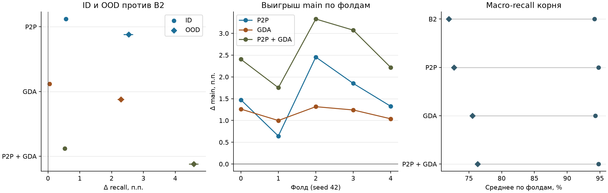

# ДЗ2. Распознавание невиданных бенгальских графем

**ResNet18 с коррекцией априорных вероятностей и гауссовым дискриминантом достигла `main = 0,9006` против 0,8751 у B2.** Прирост по пяти фолдам составил 2,56 процентного пункта (п.п.). На знакомых графемах прибавка равна 0,53 п.п., на невиданных — **4,58 п.п.** Базовая сеть уже была обучена в ДЗ1. [Все прогоны и парные сравнения](../results/hw2/summary.md)

| Вариант, seed 42 | main, среднее ± SD по 5 фолдам | Знакомые графемы (ID) | Невиданные графемы (OOD) |
|---|---:|---:|---:|
| Исходная ResNet18 (B2) | 0,8751 ± 0,0145 | 0,9593 | 0,7909 |
| Только коррекция prior (P2P) | 0,8906 ± 0,0131 | 0,9649 | 0,8163 |
| Только дискриминант (GDA) | 0,8868 ± 0,0144 | 0,9597 | 0,8139 |
| **P2P + GDA** | **0,9006 ± 0,0131** | **0,9645** | **0,8368** |



## Исследовательский вопрос

Может ли уже обученная ResNet18 лучше распознавать графемы, которые складываются из знакомых компонент в новом сочетании? В ДЗ1 модель ошиблась в корне у 25,1% примеров с невиданными написаниями и у 4,85% примеров со знакомыми. Корень имеет двойной вес в метрике. Проверяем, можно ли улучшить решение, исправив предпочтение частых классов и используя признаки формы из двух стадий той же сети. [Результаты ДЗ1](../results/summary.md) · [План, зафиксированный до расчёта](../docs/superpowers/plans/2026-11-18-hw2.md)

## Два изменения

**A. Prior2Posterior (P2P).** Пусть `z(x)` — исходные логиты одной из трёх голов. Для каждого класса вычисляем `q[c] = mean_train softmax(z(x))[c]`, затем используем `z[c] − log q[c]`. Одна голова получает 168 поправок, две другие — 11 и 7. Классам с меньшей оценённой априорной вероятностью требуется меньше свидетельств, чтобы стать первым предсказанием. Это соответствует равному весу классов в macro-recall при идеализированном изменении априорных вероятностей. Новая комбинация штрихов может также изменить распределение изображений внутри класса, поэтому знак эффекта требует эксперимента. В WACV-работе коэффициент выбирали на валидации. Мы заранее задали 1 для всех голов и фолдов и отдельно проверили замену `q` обычными частотами обучающих меток. [Bhat et al., WACV 2025, §4.3 и формула 27](https://arxiv.org/html/2412.16540v1#S4.SS3) · [Menon et al., ICLR 2021](https://arxiv.org/abs/2007.07314)

**B. Дискриминанты двух слоёв (GDA).** Снимаем средние по пространству активации третьей и четвёртой стадий ResNet18. Для каждой компоненты оцениваем по train центры классов и одну общую для классов ковариационную матрицу на слой. По оценённой матрице и расстоянию до центра получаем оценку для каждого класса. Стандартизуем вектор этих оценок по классам отдельно для каждого изображения и слоя. Среднее двух векторов прибавляем к исходным логитам. Метод авторами LE-GDA проверен на CLIP с небольшими размеченными выборками. Здесь используются все обучающие примеры фолда, три головы для компонент, два заранее заданных слоя и фиксированная регуляризация. Контроль с одним последним слоем проверяет самостоятельный вклад промежуточных признаков. [Maniamfu et al., октябрь 2026, формулы 3–8](https://arxiv.org/html/2610.34901v1) · [Реализация](../src/bengali/hw2_heads.py)

Для полной модели вычитаем `log q` из исходного вектора и прибавляем дискриминант. Удаление любого из этих двух слагаемых даёт отдельную абляцию. Веса ResNet18, сумма трёх обычных cross-entropy при её обучении, crop 128×128 и правила расчёта метрик общие для всех вариантов. Расчёт не использует список «допустимых» троек. Каждое изображение получает предсказание без информации о том, входит ли оно в ID или OOD.

## Сравнение и проверка

Каждый из пяти фолдов при seed 42 содержит около 36 тыс. знакомых примеров (ID) и 20 тыс. примеров 130 полностью отложенных написаний (OOD). Внутри среза считаем macro-recall по истинно присутствующим классам каждой компоненты, с весами 2/1/1 для корня, гласного и согласного диакритиков. Основной результат — `main = (ID + OOD)/2`, усреднённый по пяти фолдам. Фолд 0 с seed 43 и 44 отдельно показывает чувствительность к исходному обучению. Для каждого чекпойнта все варианты получают одни и те же исходные логиты. Статистики голов вычисляются только на train текущего фолда. Все ключи `(fold, seed, image_id, slice)` и предсказанные классы B2 сверяются с архивом ДЗ1. [Конфигурация](../configs/hw2.yaml) · [Журнал прогонов](../logs/hw2.log)

### Что дали абляции

- **Убрать P2P из полной модели.** `main` падает на **1,38 п.п.** (парный 95% ДИ для вклада P2P от 1,30 до 1,46), OOD — на 2,29 п.п. Сама по себе коррекция особенно помогла согласному диакритику на OOD: его macro-recall поднялся с 0,8019 до 0,8755. Некоторые частые классы при этом стали распознаваться хуже.
- **Убрать GDA из полной модели.** `main` падает на **1,01 п.п.** (ДИ от 0,96 до 1,05), OOD — на 2,05 п.п. На ID удаление даёт небольшое улучшение, около 0,04 п.п. Дискриминант особенно полезен корню на OOD: сам по себе он поднимает macro-recall с 0,7194 до 0,7551. Вклады частично перекрываются, сумма их отдельных выигрышей превышает фактический совместный эффект примерно на 0,17 п.п. [Обе абляции и взаимодействие](../results/hw2/summary.md)

### Где появились и исчезли ошибки

На 101 088 OOD-изображениях полная модель исправила **5 348** ошибочных троек B2 и внесла **2 226** новых ошибок. Доля изображений с хотя бы одной ошибкой снизилась с 31,62% до 28,53%. Среди OOD-ошибок доля ответов со знакомой по обучению тройкой снизилась с 88,09% до 80,94%. В расчёте на все OOD-изображения эта доля упала с 27,85% до 23,09%. На ID доля ошибочных троек, наоборот, выросла с 6,62% до 6,99%. Одиночный GDA дал минимальную частоту OOD-ошибок по целой тройке среди четырёх основных вариантов (28,18%), хотя комбинация лидирует по основной метрике. Macro-recall придаёт редким классам больше веса, чем простой подсчёт ошибочных изображений. [Количество исправлений и новых ошибок по каждой голове](../results/hw2/summary.md)

Наибольший выигрыш по корню наблюдается для 43 пар «фолд, корень», в которых обучение содержало всего одну или две разные графемы с таким корнем. Их средний OOD-recall вырос с 0,3935 до 0,5642. Для корней с более чем десятью контекстами изменение мало: 0,8370 → 0,8366. Связь частоты класса с разнообразием написаний в этих данных мешает разделить их вклад. [Число примеров, состав групп и результаты всех вариантов](../results/hw2/diagnostics.md)

**Что оказалось слабее ожиданий.** Контроль с обычной частотой меток дал те же 0,8906, что и P2P, при округлении до четырёх знаков. ДИ разности включает ноль. Добавление стадии 3 к дискриминанту стадии 4 дало всего +0,029 п.п. по `main` (ДИ от −0,003 до +0,062 п.п.). Эксперимент подтверждает пользу поправки на дисбаланс и самого дискриминанта. Самостоятельное преимущество более сложных вариантов в этих двух сравнениях остаётся неопределённым. [Контрольные сравнения](../results/hw2/diagnostics.md)

### Насколько устойчив выигрыш

Прирост полной модели положителен на **5 из 5** фолдов, от 1,75 до 3,33 п.п. Парный 95% интервал среднего прироста `main` составляет **[2,48; 2,63] п.п.**, а заранее выбранный порог по разбросу seed — 0,48 п.п. На фолде 0 при трёх инициализациях прирост составил 2,40, 2,51 и 2,48 п.п. Полная модель проходит все четыре условия выбора из ДЗ1. [Критерии, интервалы и seed](../results/hw2/summary.md)

Исключили 6 085 ID-наблюдений с известной почти точной копией в train и 586 OOD-наблюдений, чья истинная тройка встретилась в train под другим написанием. На оставшихся строках `main` равен 0,9002 у полной модели и 0,8745 у B2. Так измерено влияние известных пересечений на оценку при фиксированных весах. [Анализ чувствительности](../results/hw2/summary.md)

В 281 707 валидационных наблюдениях 80 867 физических изображений используются дважды под разными чекпойнтами. Дополнительно повторили оценку интервала с одним общим случайным весом на `image_id` для всех его появлений. Получили интервал **[2,47; 2,63] п.п.** для Δmain. Оба интервала описывают выборку изображений при фиксированных графемах и моделях. Гипотезы возникли после анализа ошибок ДЗ1 на тех же фолдах. Для независимой оценки переноса на новых авторов нужна отдельная размеченная выборка. Результат на скрытом тесте Kaggle неизвестен. Для дополнительных сравнений приведены номинальные интервалы. [Бутстрап по физическим изображениям](../results/hw2/image_bootstrap.md)

## Что ещё предложила литература

| Работа | Что можно перенести на эту задачу |
|---|---|
| [Balanced Meta-Softmax, NeurIPS 2020](https://arxiv.org/abs/2007.10740) | Кандидат для нового обучения — считать `CE(z + log n, y)` отдельно для каждой головы, используя частоты только из train фолда. Это изменит градиенты и признаки энкодера. В этом ДЗ сравнение P2P с частотной поправкой проверяет, какая часть эффекта достижима на прежних весах. |
| [Wu et al., июль 2025](https://arxiv.org/abs/2507.17377) | Авторы моделируют атрибут условно на объекте при распознавании новых композиций. Бенгальский аналог — диакритик условно на вероятностном представлении корня. Риск состоит в усилении тяги к знакомым тройкам, поэтому такой вариант стоит сравнивать по OOD и разбирать ошибки комбинаций. |
| [Wang et al., апрель 2026](https://arxiv.org/abs/2604.01506) | В REPAIR классозависимые смещения дополнены поправкой для конкурирующих ответов. Метод оценивает параметры на отдельной размеченной калибровочной выборке и анализирует случаи, где правильный класс попал в список кандидатов. Для нашего протокола потребовалось бы выделить калибровку внутри train. |
| [Confidence-Guided Diffusion Augmentation, май 2026](https://arxiv.org/html/2605.10916v2) | Для рукописных бенгальских знаков авторы генерируют и фильтруют синтетические изображения. Их эксперимент использует 171 класс целых знаков AIBangla. В Bengali.AI потребуется отдельно проверять, сохраняет ли генератор все три компоненты, прежде чем приписывать ему выигрыш на новых графемах. |

Affine + CutMix и более длительное обучение были гипотезами ДЗ1. Здесь выбран эксперимент, который сохраняет веса и позволяет непосредственно сравнить шесть правил предсказания. Его результаты оставляют открытым вопрос об эффекте аугментаций и другой функции потерь.

## Как повторить

Команды выполняются из корня репозитория с Python 3.11–3.12 и `uv`. Для доступа к изображениям и истинным меткам нужны данные соревнования. Скрипт загрузки и порядок получения доступа описаны в основном README. [Подготовка среды и данных](../README.md#0-как-запустить)

```bash
uv sync --frozen
bash scripts/download_data.sh
uv run --frozen python -m bengali.data --size 128 --workers 8
```

Из чистого клона следующие команды обучают B2 только на семи необходимых сочетаниях, строят его эталонные предсказания, проводят все абляции и пересчитывают отчёты. Чекпойнты создаются в `checkpoints/b2_hw2_rebuilt`, эталон и результаты этого воспроизведения — в `data/hw2-rebuilt`. На другом устройстве корректность парного сравнения проверяется относительно заново обученного экземпляра B2. Время и точное совпадение его весов зависят от бэкенда.

```bash
bash scripts/run_hw2.sh --rebuild-baseline
uv run --frozen pytest -q
```

При наличии исходных семи чекпойнтов ДЗ1 команда `bash scripts/run_hw2.sh` записывает результаты в `results/hw2`. Для пересчёта опубликованных таблиц и графика достаточно официального `data/raw/train.csv` и команды `bash scripts/run_hw2.sh --analyze`. Изображения и веса для этого пересчёта не требуются. В каждом каталоге запуска сохранены конфиг, метрики и предсказания с идентификаторами примеров. Хеши чекпойнта, файла разбиения и исходных предсказаний находятся в `metrics.json`. Время работы указано для совместного расчёта вариантов на одном чекпойнте.

Журнал охватывает 42 оценки: четыре основных варианта и два контроля на семи чекпойнтах. На Apple M4 Pro извлечение признаков, оценка статистик и валидация всех шести вариантов заняли примерно 54–66 секунд на чекпойнт, без времени записи файлов. [28 основных оценок с конфигами и метриками](../results/hw2/experiments.csv) · [14 контрольных оценок](../results/hw2/controls/experiments.csv)

Исследовательские и программные материалы подготовлены при участии Codex. Поиск и проверка первоисточников опирались на процедуру Research Lookup из [Scientific Agent Skills](https://arxiv.org/abs/2609.00065).
