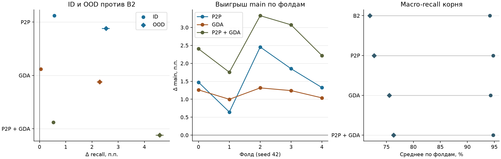

# ДЗ2. Результаты эксперимента

Каждая ячейка проверена на пяти фолдах с seed 42 и на фолде 0 с seed 43 и 44. Во всех ячейках совпадают изображения и срезы каждого запуска. Во всех семи запусках предсказанные классы B2 полностью совпали с архивом ДЗ1. В таблице среднее ± выборочное стандартное отклонение по пяти фолдам с seed 42.

| Ячейка | main | ID | OOD | ID root / vowel / consonant | OOD root / vowel / consonant |
|---|---:|---:|---:|---:|---:|
| B2 | 0.8751 ± 0.0145 | 0.9593 ± 0.0028 | 0.7909 ± 0.0298 | 0.9418 / 0.9810 / 0.9724 | 0.7194 / 0.9230 / 0.8019 |
| P2P | 0.8906 ± 0.0131 | 0.9649 ± 0.0015 | 0.8163 ± 0.0265 | 0.9480 / 0.9834 / 0.9802 | 0.7272 / 0.9354 / 0.8755 |
| GDA | 0.8868 ± 0.0144 | 0.9597 ± 0.0025 | 0.8139 ± 0.0294 | 0.9428 / 0.9808 / 0.9726 | 0.7551 / 0.9280 / 0.8171 |
| P2P + GDA | 0.9006 ± 0.0131 | 0.9645 ± 0.0020 | 0.8368 ± 0.0267 | 0.9479 / 0.9830 / 0.9793 | 0.7633 / 0.9391 / 0.8813 |

## Парные эффекты

Эффекты измерены в единицах recall. Взаимодействие равно `(P2P + GDA) − P2P − GDA + B2`. Положительное `ΔOOD − ΔID` означает больший выигрыш на невиданных графемах.

| Контраст | Δmain [95% ДИ] | ΔID [95% ДИ] | ΔOOD [95% ДИ] | ΔOOD − ΔID [95% ДИ] | Фолдов с Δmain > 0 |
|---|---:|---:|---:|---:|---:|
| p2p-b2 | +0.0155 [+0.0146, +0.0163] | +0.0056 [+0.0050, +0.0063] | +0.0254 [+0.0238, +0.0268] | +0.0197 [+0.0181, +0.0213] | 5/5 |
| gda-b2 | +0.0117 [+0.0112, +0.0123] | +0.0005 [+0.0002, +0.0008] | +0.0229 [+0.0219, +0.0239] | +0.0224 [+0.0214, +0.0235] | 5/5 |
| both-b2 | +0.0256 [+0.0248, +0.0263] | +0.0053 [+0.0046, +0.0059] | +0.0458 [+0.0443, +0.0473] | +0.0406 [+0.0388, +0.0420] | 5/5 |
| both-p2p | +0.0101 [+0.0096, +0.0105] | -0.0004 [-0.0006, -0.0001] | +0.0205 [+0.0196, +0.0213] | +0.0208 [+0.0199, +0.0217] | 5/5 |
| both-gda | +0.0138 [+0.0130, +0.0146] | +0.0048 [+0.0042, +0.0054] | +0.0229 [+0.0214, +0.0242] | +0.0181 [+0.0165, +0.0196] | 5/5 |
| interaction | -0.0017 [-0.0023, -0.0010] | -0.0008 [-0.0013, -0.0004] | -0.0025 [-0.0037, -0.0013] | -0.0016 [-0.0029, -0.0004] | 1/5 |

Для 95% ДИ использован парный процентильный бутстрап (1000 реплик). Изображения пересэмплируются с возвращением внутри графемы, фолда и среза. Каждая реплика использует одни и те же строки для четырёх ячеек и заново вычисляет среднее по фолдам. Интервалы условны на данных графемах и чекпойнтах. ID авторов неизвестны. Одно изображение может участвовать в разных фолдах, а обучающие выборки пересекаются.

## Критерий выбора из ДЗ1

Порог по обучающему seed равен 0.004808 (два стандартных отклонения B2 на фолде 0). Остальные условия требуют положительного Δmain на ≥4 фолдах, положительной нижней границы 95% ДИ Δmain и нижней границы 95% ДИ ΔOOD выше −0.005.

| Ячейка | ≥4 фолда | ДИ Δmain > 0 | Δmain > порога seed | ДИ ΔOOD выше −0.005 | Проходит |
|---|---:|---:|---:|---:|---:|
| P2P | да | да | да | да | да |
| GDA | да | да | да | да | да |
| P2P + GDA | да | да | да | да | да |

## Чувствительность к обучающему seed

Сравнения с B2 на фолде 0 используют одинаковый чекпойнт в каждой паре.

| Ячейка | Seed | main | ID | OOD | Δmain | ΔID | ΔOOD |
|---|---:|---:|---:|---:|---:|---:|---:|
| B2 | 42 | 0.8947 | 0.9601 | 0.8293 | +0.0000 | +0.0000 | +0.0000 |
| B2 | 43 | 0.8912 | 0.9598 | 0.8226 | +0.0000 | +0.0000 | +0.0000 |
| B2 | 44 | 0.8958 | 0.9600 | 0.8316 | +0.0000 | +0.0000 | +0.0000 |
| P2P | 42 | 0.9094 | 0.9658 | 0.8530 | +0.0147 | +0.0058 | +0.0237 |
| P2P | 43 | 0.9069 | 0.9657 | 0.8482 | +0.0157 | +0.0059 | +0.0256 |
| P2P | 44 | 0.9116 | 0.9647 | 0.8585 | +0.0158 | +0.0047 | +0.0269 |
| GDA | 42 | 0.9073 | 0.9605 | 0.8540 | +0.0126 | +0.0005 | +0.0248 |
| GDA | 43 | 0.9022 | 0.9606 | 0.8439 | +0.0110 | +0.0008 | +0.0213 |
| GDA | 44 | 0.9088 | 0.9599 | 0.8576 | +0.0129 | -0.0001 | +0.0260 |
| P2P + GDA | 42 | 0.9187 | 0.9654 | 0.8720 | +0.0240 | +0.0053 | +0.0427 |
| P2P + GDA | 43 | 0.9163 | 0.9650 | 0.8676 | +0.0251 | +0.0052 | +0.0450 |
| P2P + GDA | 44 | 0.9206 | 0.9644 | 0.8768 | +0.0248 | +0.0044 | +0.0452 |

## Ошибки и знакомые тройки на OOD

Ошибки ниже посчитаны по изображениям. В скобках число исправленных и новых ошибок относительно B2. Тройка считается знакомой, если она встречалась в train того же фолда.

| Ячейка | Срез | N | Корень | Гласный | Согласный | Тройка |
|---|---|---:|---:|---:|---:|---:|
| B2 | ID | 180619 | 4.85% (0/0) | 1.30% (0/0) | 1.48% (0/0) | 6.62% (0/0) |
| B2 | OOD | 101088 | 25.10% (0/0) | 4.96% (0/0) | 4.64% (0/0) | 31.62% (0/0) |
| P2P | ID | 180619 | 5.10% (812/1269) | 1.37% (213/339) | 1.71% (477/895) | 7.17% (1069/2052) |
| P2P | OOD | 101088 | 25.54% (2244/2685) | 5.19% (723/950) | 5.23% (1337/1935) | 32.78% (3420/4602) |
| GDA | ID | 180619 | 4.85% (328/328) | 1.30% (62/67) | 1.49% (66/92) | 6.66% (373/432) |
| GDA | OOD | 101088 | 22.10% (3143/113) | 4.56% (494/88) | 4.36% (357/76) | 28.18% (3666/191) |
| P2P + GDA | ID | 180619 | 5.02% (757/1070) | 1.33% (181/246) | 1.63% (406/671) | 6.99% (965/1631) |
| P2P + GDA | OOD | 101088 | 22.27% (4125/1267) | 4.64% (811/485) | 4.44% (1354/1151) | 28.53% (5348/2226) |

| Ячейка | OOD-срез | N | Ошибки тройки | Ошибки со знакомой тройкой | Доля среди ошибок | Доля среди всех |
|---|---|---:|---:|---:|---:|---:|
| B2 | все | 101088 | 31959 | 28152 | 88.09% | 27.85% |
| B2 | новая истинная тройка | 100502 | 31809 | 28006 | 88.04% | 27.87% |
| P2P | все | 101088 | 33141 | 27026 | 81.55% | 26.74% |
| P2P | новая истинная тройка | 100502 | 32982 | 26876 | 81.49% | 26.74% |
| GDA | все | 101088 | 28484 | 24685 | 86.66% | 24.42% |
| GDA | новая истинная тройка | 100502 | 28328 | 24533 | 86.60% | 24.41% |
| P2P + GDA | все | 101088 | 28837 | 23341 | 80.94% | 23.09% |
| P2P + GDA | новая истинная тройка | 100502 | 28679 | 23190 | 80.86% | 23.07% |

## Чувствительность к утечкам из ДЗ1

Повторная оценка исключает 6085 ID-изображений с известной копией в train и 586 OOD-изображений, чья истинная тройка встречалась в train. Исключения одинаковы для четырёх ячеек. Чекпойнты обучены на исходных фолдах.

| Ячейка | ID без копий | OOD без знакомых истинных троек | main без обоих | Δmain к B2 без обоих |
|---|---:|---:|---:|---:|
| B2 | 0.9579 | 0.7912 | 0.8745 | +0.0000 |
| P2P | 0.9637 | 0.8165 | 0.8901 | +0.0156 |
| GDA | 0.9584 | 0.8141 | 0.8863 | +0.0117 |
| P2P + GDA | 0.9633 | 0.8370 | 0.9002 | +0.0256 |
